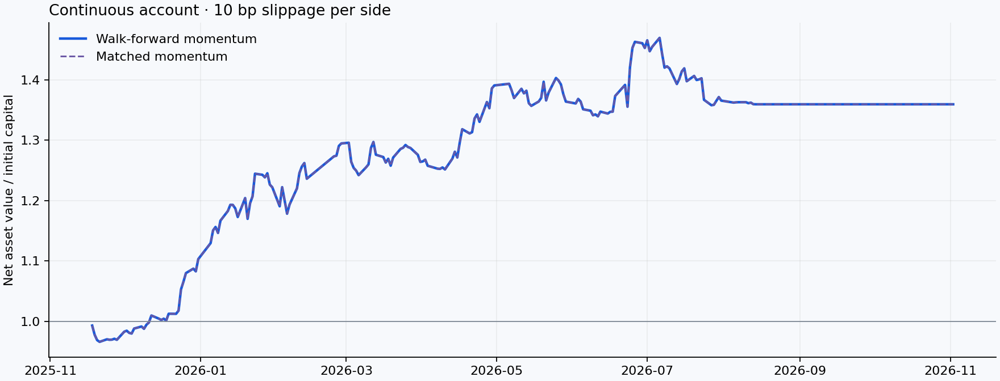

# Quantify

[](https://github.com/Aaa312-tech/Quantify/actions/workflows/ci.yml)

A股模拟投资研究项目，Python包与命令名为`quantfolio`。当前采用**滚动选型动量**策略：动量候选池、行业残差模型、滚动验证选型、次日开盘模拟。使用均衡进攻和8%回撤预警；仓位降级后不恢复。

**当前仅作研究，尚未证明超越同风控动量。** 活跃快照已推进到11月20日，完成登记的多来源校验、完整重训及账户审计。原数据、模型和账本保留；最新证据见[行情扩展验收](artifacts/checks/daily_source_extension_2026-11-21/attribution.json)。

| 每边滑点，另计交易费 | 滚动选型动量净收益 | 同风控动量净收益 | 最大回撤 | 10日账户平均净收益 |
| --- | ---: | ---: | ---: | ---: |
| 10bp | 36.53% | 36.53% | -6.63% | 2.05% |
| 20bp | 6.40% | 6.40% | -6.41% | 0.74% |
| 30bp | 12.02% | 12.02% | -6.50% | 1.10% |

回测区间为2025-11-18至2026-11-02。23个完整10日账户分别重置本金，其均值不等于连续收益；末尾还有一个不足10日的账户。各成本档重新计算订单和风险路径，收益不必随成本单调变化，不能选择最高历史收益的一档作为真实成交成本。8%是预警和退出目标，不保证实际回撤上限。

本轮完成48次拟合、1425个重训账户、1425个固定旧预测对照及75个纸面账户核对。48个模型候选与窗口组合均未通过采用门槛，12个窗口仍选择动量。旧输入兼容性另以1425个完整账户验证。历史行业、股票池选择、其他证券状态及全表公司行为覆盖仍不完整。

11月23日[条件式纸面计划](artifacts/plans/reviewed_sources_2026-11-23/plan.md)已提前冻结，建议保持100万元模拟现金。567个合格标的均未通过当前模型的净收益建仓门槛，暂无买入意向。

行情、账户和最新拟合均对应11月20日，计划有效期止于11月23日09:25。前向收益尚未发生，超额收益门槛仍未通过。数据限制与后续工作见[数据契约](docs/data_contract.md)和[修正记录](docs/remediation.md)。

此前规则实验、仓位恢复和失败候选保存在[策略实验](docs/strategy_study.md)与[卖出预算研究](docs/exit_budget_repair.md)，均未据此放宽当前风控。



## 运行

已验证环境：Windows、Python 3.13.2。先安装Git LFS，再获取数据和模型：

```powershell
git lfs install
git clone https://github.com/Aaa312-tech/Quantify.git
Set-Location Quantify
git lfs pull
python -m venv .venv
.\.venv\Scripts\python -m pip install -e '.[dev]'
.\.venv\Scripts\python -m quantfolio status
.\.venv\Scripts\python -m quantfolio verify
.\.venv\Scripts\python -m quantfolio report
```

以上为Windows命令；Linux使用`.venv/bin/python`。源码ZIP可能只包含LFS指针。训练、评估与报告读取本地数据；`fetch-bars`另行采集日线，原始下载不会自动成为活跃快照。从其他目录运行时指定`--project PATH`。完整训练、重放和环境限制见[复现指南](docs/reproducibility.md)。

## 研究流程

沿用上面创建的虚拟环境，依次运行：

```powershell
.\.venv\Scripts\python -m quantfolio train --first 1 --last 1 --output artifacts/experiments/example_run
.\.venv\Scripts\python -m quantfolio evaluate --run artifacts/experiments/example_run --output artifacts/evaluations/example_run
.\.venv\Scripts\python -m quantfolio report --run artifacts/evaluations/example_run
```

示例仅运行一个窗口，结果会标为`PARTIAL`。完整训练、成本选择和冻结重放见[复现指南](docs/reproducibility.md)。新实验不会自动替换主策略；报告可从对应的`reports/experiments`目录打开。

## 纸面观察

`account-init → plan → resolve-plan → account-close`连接收盘账户、提前冻结的次日意向、手工开盘报价与收盘结转。它复用原策略并保留风险高水位，已通过75个历史账户、1386个交易日的完整账本对比；这不构成新增前向样本。

当前数据、最新拟合和100万元纯现金纸面账户均对应11月20日。11月23日计划在开盘前冻结，尚无开盘成交或前向收益；旧的过期就绪记录保留。输入格式、时点和已知换手限制见[纸面流程](docs/paper_workflow.md)。

11月20日新快照使用固定的三组来源覆盖594只证券：原主来源414只，BaoStock补齐178只，腾讯北交所日线覆盖另外2只。此前腾讯报价的17项换手率差异和2项金额校验失败保留；新核查另发现前一日18只ETF的换手率口径差异。原失败核验记录和来源限制均保留，详见[来源就绪审查](artifacts/checks/market_close_2026-11-20/source_readiness_review.json)。

## 目录

| 路径 | 内容 |
| --- | --- |
| `src/quantfolio/` | 特征、训练、选股、模拟、独立核账及命令入口 |
| `tests/` | 合成数据上的交易规则与因果性测试 |
| `configs/` | 项目路径、实验协议、历史名称映射和冻结文件SHA-256清单 |
| `data/processed/` | 原快照及核验公司行为后的独立快照 |
| `data/raw/` | 按截止日归档的行情响应、覆盖和修订检查；不会自动用于研究 |
| `artifacts/reference/2026-11-19/` | 冻结训练、预测和回测账本 |
| `artifacts/experiments/`、`artifacts/evaluations/` | 新训练及对应评估；每次使用新名称 |
| `artifacts/accounts/`、`artifacts/plans/` | 纸面收盘账户、条件式计划、手工报价及开盘核算；按账户与日期归档 |
| `artifacts/checks/`、`artifacts/replays/` | 当前模型校验、迁移核对和完整账本重放结果 |
| `docs/` | 方法、架构、复现说明及来源材料 |
| `reports/latest/` | 当前配置的研究评估报告与净值图 |
| `scripts/` | PowerShell运行、检查和同步入口 |

## 开发

```powershell
scripts/check.ps1 -Python '.\.venv\Scripts\python'
scripts/sync.ps1 -Python '.\.venv\Scripts\python' -Message 'refactor: describe the change'
```

同步脚本依次检查、提交、推送并等待CI。CI构建并安装wheel，在Windows和Ubuntu上测试；完整历史验证需本地LFS数据。重构应保持账本相同；成交错误修正必须保留旧引擎复现证据，并单独记录新模型的差异。

[代码约定与参考实现](CONTRIBUTING.md) · [架构](docs/architecture.md) · [方法](docs/methodology.md) · [仓库维护](docs/repository.md) · [本地报告](reports/latest/index.html) · [变更记录](CHANGELOG.md)
