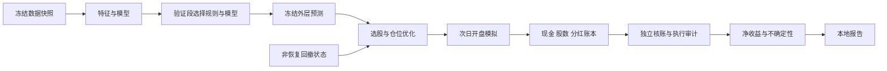

# 项目结构

| 模块 | 职责 |
| --- | --- |
| `cli` / `settings` | 命令、根目录发现、输出目录隔离 |
| `storage` / `dataset` | 原子写入、哈希、可信本地快照及特征验证 |
| `transforms` / `features` | 价格特征、横截面排序、同行业相对特征 |
| `splits` / `calibration` | 滚动窗口、标签结束日净化、历史收益校准 |
| `estimators` / `models` | 固定模型、行业残差目标、混合排序、行业检验 |
| `selection` / `training` | 只使用过去验证段选择规则和模型，再重训 |
| `rules` / `allocation` | 七项换手开关、选股、线性规划仓位 |
| `risk` / `market` | 不恢复风控、市场状态、开盘成交约束 |
| `ledger` / `simulation` | 整数股、T+1、现金应收、公司行为与逐日模拟 |
| `reconciliation` / `audit` | 独立验证账务、信号时序及成交后仓位 |
| `metrics` / `evaluation` | 收益统计、区间估计、冻结账户精确重放 |
| `verification` / `reporting` | 模型复载、独立重训检查、本地展示 |

核心运行没有固定盘符，也没有旧版本包的导入。`data`和`artifacts`放在项目根目录，独立于可安装Python包；因此从其他目录运行时需指定 `--project`。

冻结产物中的 `recovery`、`v4_rank_*`、`selected_legacy` 等字段保留原有数据协议，避免破坏模型特征名和历史哈希。它们不表示项目中还维护另一套恢复策略；活动风险控制器仅接受 `latched`。

冻结数据包保存原始价格、公司行为、面板、标签、特征和股票元数据，不依赖旧数据文件夹。新行情接入应遵循 [数据契约](data_contract.md)，单独建立新的经过审核的快照。
