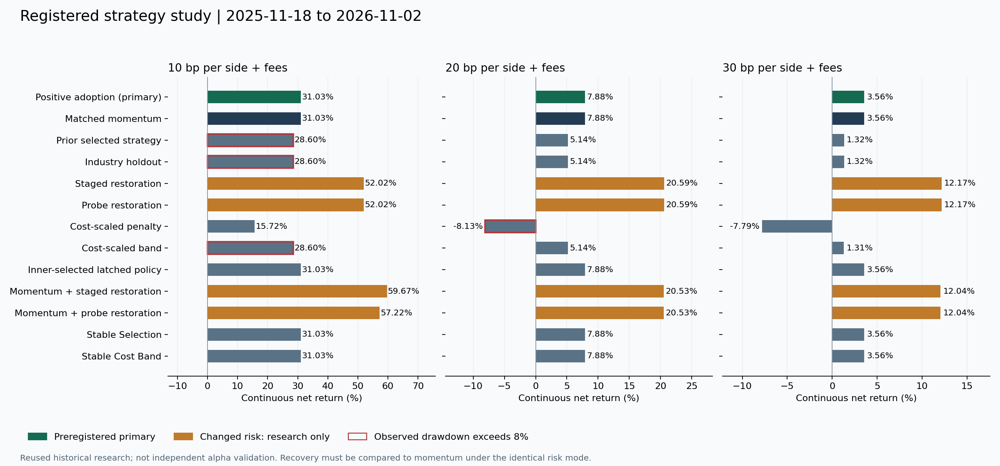

# 选型、恢复与换手实验

实验协议在提交`24b9805`登记，见[完整协议](../configs/protocols/strategy_study.json)。
数据固定为11月19日快照，估计器、特征、训练标签及校准不变；每个历史窗口和最新一期
重新拟合Ridge与树模型，共48次拟合，并独立重载与重拟合核验。

| 单独改动 | 固定定义 |
| --- | --- |
| `positive_adoption` | 采用模型或换手规则须满足原门槛，且成对平均超额减标准误严格大于零 |
| `industry_holdout` | 按验证期候选数量选择五个主要行业，逐个剔除后均须有正的行业残差IC与组间收益差；不使用标签选择行业 |
| `staged_restore` | 状态保持至少5次观察且市场连续健康3次；回撤低于5%才从20%恢复至45%，低于2.5%才从45%恢复至90% |
| `probe_restore` | 在逐级恢复之外，冻结至少10次观察、市场健康5次且回撤低于7%才允许20%试探；回撤达7%重新冻结 |
| `cost_penalty` | 优化中每边额外惩罚为该证券估计双边交易成本的一半，实际现金费用不重复扣除 |
| `cost_band` | 持仓目标缓冲为双边估计成本的两倍，限制在0.5至2个百分点之间；不阻止必要减仓 |

健康市场沿用此前定义：基准高于20日均线、合格证券中至少55%趋势为正、基准近5日上涨。
所有风险模式保留原始净值高水位；8%退出是永久状态，恢复策略也不能重启。

只允许两种组合：正采用评分加行业检验、正采用评分加成本缓冲。只有两项组成规则
均通过内层成对检验，才测试其组合；未满足条件的组合明确记录为未测试，不改试其他组合。
`inner_selected`只可根据内层证据选择不恢复的候选，默认使用基础规则动量；恢复候选另行比较。

```powershell
python -m quantfolio study --output artifacts/experiments/strategy_study_2026-11-20
python -m quantfolio evaluate-study --run artifacts/experiments/strategy_study_2026-11-20 --output artifacts/evaluations/strategy_study_2026-11-20
```

训练、候选验证与选择记录位于实验目录；模型重载和独立重拟合放在同名的`artifacts/checks`
目录。全部窗口的选择须先冻结，`evaluate-study`才会计算外层账户。评估根目录中的标准
`evaluation_summary.json`对应事先指定的`positive_adoption`主候选；`study_summary.json`
汇总其他候选、同风险恢复动量及跳过的组合，逐笔账本位于`alternatives`。

当前历史数据已被多次研究。负采用评分的问题也来自已观察的第7窗口，因此本研究不能
作为独立的收益验证。报告保留每项候选的所有成本情形、回撤、费用、换手、风险状态及数据质量。
主候选只有在工程核验通过、三档连续净收益均不下降且观察到的最大回撤均在8%内时，
才可作为回顾性的选型稳健性修改启用；这不代表新增超额收益。恢复候选继续保持研究用途。

## 完整结果

运行代码冻结在`70ff3bc`。11个历史窗口及最新一期的48次拟合已完成；所有模型重载、
首窗口两次独立重拟合的误差为零。全部12个窗口的选择在2026-11-20 14:42:29前冻结，
随后运行外层评估。数据截止11月19日，外层成交区间为2025-11-18至2026-11-02。

下表均为同一231日连续账户，单元格依次为**净收益 / 最大回撤**。每档另计交易费用。
23个完整10日账户及1个尾段账户另存，不能把这些重置本金账户的均值当作连续收益。

| 策略或对照 | 每边10bp | 每边20bp | 每边30bp |
| --- | ---: | ---: | ---: |
| 正采用评分，事先指定的主候选 | 31.03% / -6.53% | 7.88% / -6.40% | 3.56% / -6.94% |
| 同风控动量，不恢复 | 31.03% / -6.53% | 7.88% / -6.40% | 3.56% / -6.94% |
| 原选型策略 | 28.60% / -8.05% | 5.14% / -7.46% | 1.32% / -7.58% |
| 行业剔除检验 | 28.60% / -8.05% | 5.14% / -7.46% | 1.32% / -7.58% |
| 逐级恢复 | 52.02% / -7.86% | 20.59% / -7.56% | 12.17% / -7.72% |
| 试探恢复 | 52.02% / -7.86% | 20.59% / -7.56% | 12.17% / -7.72% |
| 成本比例惩罚 | 15.72% / -6.44% | -8.13% / -8.13% | -7.79% / -7.92% |
| 成本比例缓冲 | 28.60% / -8.05% | 5.14% / -7.46% | 1.31% / -7.58% |
| 动量加逐级恢复 | 59.67% / -6.18% | 20.53% / -7.59% | 12.04% / -7.81% |
| 动量加试探恢复 | 57.22% / -7.09% | 20.53% / -7.59% | 12.04% / -7.81% |
| 内层选择的不恢复策略 | 31.03% / -6.53% | 7.88% / -6.40% | 3.56% / -6.94% |
| 正采用评分加行业检验 | 31.03% / -6.53% | 7.88% / -6.40% | 3.56% / -6.94% |
| 正采用评分加成本缓冲 | 31.03% / -6.53% | 7.88% / -6.40% | 3.56% / -6.94% |



正采用评分仅改变第7窗口的模型采用决定：原Ridge混合候选的平均超额减标准误为
-0.1852个百分点，新门槛拒绝采用，回到动量。三档连续净收益较原策略分别增加
2.43、2.74、2.24个百分点，与同风控动量完全持平，不能解释为获得了新预测优势。

行业剔除检验没有改变任何窗口的采用结果。第7窗口的Ridge模型通过五个剔除检验，
仍未在外层延续收益；行业稳定性检查不能替代收益验证。当前行业分类也不是历史时点数据。

两种组合仅在第6窗口满足内层测试条件，其余窗口，包括最新一期，均记录为
`NOT_TESTED_COMPONENT_GATE`并回退到基础动量。第6窗口所有单项与组合的采用评分
恰好相同，均为0.00105758；共同使用的原有`add_penalty10`规则解释了内层优势。
`inner_selected`依照“改动数量、名称”的固定平局顺序选择成本缓冲，不能称为
证实了成本缓冲或组合的独立增益。未增加其他候选或参数搜索。

## 收益差异的来源

逐级恢复保留原高水位，在持续回升后允许仓位重新增加。它在三档成本下的连续收益
均高于原不恢复策略，但必须与相同恢复规则的动量比较：10bp档仍落后7.65个百分点，
20bp与30bp档仅领先0.06与0.13个百分点。试探恢复候选在三条连续路径中均未实际
进入试探状态，所以与逐级恢复完全相同；纯动量的10bp路径进入过一次试探，收益反而
低于逐级恢复动量。恢复机制的历史收益值得后续前向观察，相关结果仅用于历史研究。

成本比例惩罚三档均降低净收益。10bp档的首次成交差异出现在2025-12-23，最终现金费用
只少110.39元，净收益金额却少128887.10元，主要差异来自持仓与随后的风险路径。
20bp档少支付31949.77元费用，但净收益金额少132748.13元；节省成本并未弥补持仓损失。
这些是各自路径的核算差额，不是独立的零成本反事实回测。

成本缓冲在三档连续路径分别触发2、5、5次。前两档的整数成交与净值完全不变；
30bp档仅少支付59.21元费用，净收益金额减少81.79元。当前目标仓位与整数股约束下，
这项改动没有改善净收益。首次目标、成交差异及状态归因见
[归因记录](../artifacts/checks/strategy_study_2026-11-20/attribution.json)。

## 验收和后续使用

2325个外层账户通过755094项独立核账和1275875项执行审计。292份内层试验包含
2336个账户，也全部通过独立账户审计；其中仍有33项未核实公司行为、175次重复出现，
质量门槛没有放宽。每个候选的完整成本、换手、暴露、拒单与风险状态见
[评估汇总](../artifacts/evaluations/strategy_study_2026-11-20/study_summary.json)，
内层问题见[质量清单](../artifacts/checks/strategy_study_2026-11-20/inner_quality.json)。

原48个模型文件、保存预测和12组外层预测数组完全一致；原1425个账户的完整摘要与
账本精确复现。4122项此前冻结文件哈希未变。主候选通过登记的三档净收益、8%观察回撤
和完整旧结果一致性条件，已启用`positive_score`选型模式；完整证据见
[比较与验收](../artifacts/checks/strategy_study_2026-11-20/comparison.json)。
收益优势及前向验证仍未通过。恢复候选继续研究，下一阶段接入手工账户输入、
数据时效检查和条件式次日计划；已经发生的开盘不补写为前向建议。
